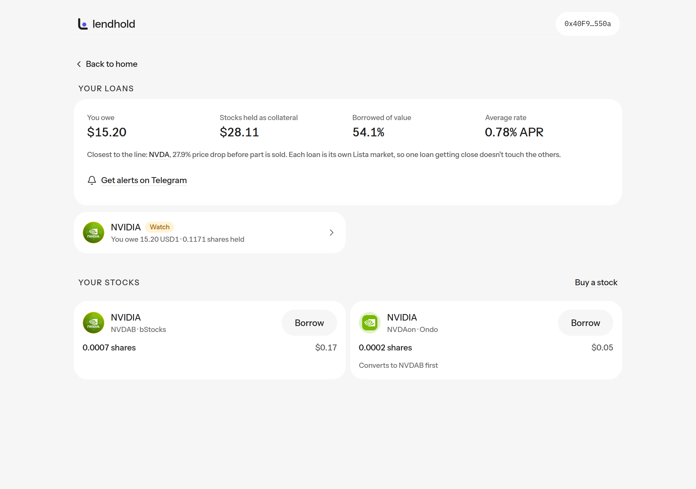
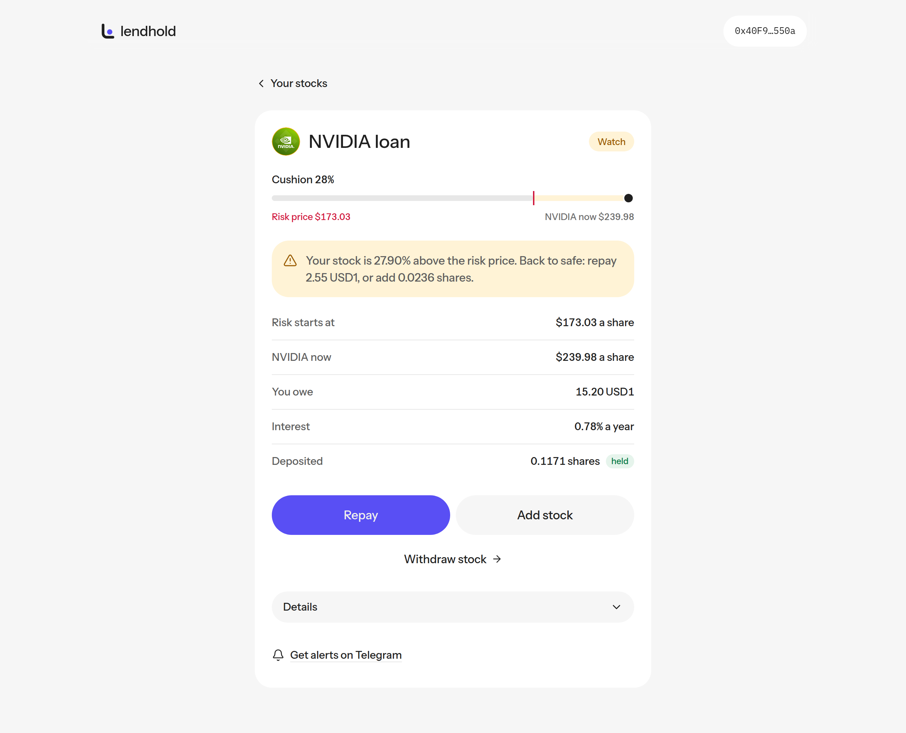
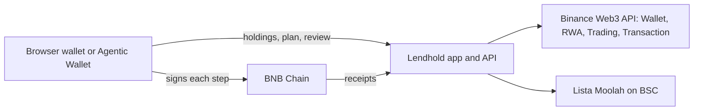

# Lendhold

Borrow against your tokenized stocks on BNB Chain. Keep them.

[](https://github.com/mystiquemide/lendhold/actions/workflows/ci.yml)

Live app: [lendhold.midelabs.xyz](https://lendhold.midelabs.xyz) · Demo video: pending · [Run history](https://lendhold.midelabs.xyz/proof)

## The problem

People outside the US who hold US stocks and need dollars usually have two options: sell the position, or go without.

> "Tokenized stocks as collateral to get stablecoins. Is there such a project now?" ([r/defi](https://www.reddit.com/r/defi/comments/1lpbisu/))

> "the ibkr interest charged is waaaaaaaay better than anything I could access at my country of residence." A non-US investor planning a margin loan instead of selling ([r/interactivebrokers](https://www.reddit.com/r/interactivebrokers/comments/1w5nvfw/), Sep 2026)

On BNB Chain, 618 stock tokens are live across three issuers: 442 Ondo, 130 xStocks and 46 bStocks (Binance Web3 RWA API, 5 Oct 2026).
Only bStocks are accepted as collateral on BSC lending markets, so most holders have no way to borrow against what they own.
Where borrowing does exist, on Lista Lending, it runs through interfaces built for DeFi users: approve, deposit, borrow and swap, one step at a time.

## The solution

Lendhold lets you borrow dollars against your stock tokens instead of selling them. Repay the loan and the stock comes back to you.

- **One flow.** Pick a stock and an amount. Lendhold builds the approve, deposit, borrow and optional swap to USDT, checks each step on-chain, and you sign from your own wallet.
- **Ondo works too.** Ondo tokens are swapped into the matching bStock first. You see the shares you'll end up with and what the swap costs before you sign.
- **Risk up front.** You see the safe amount and the price where Lista would start selling your stock. The safe amount drops when the US market is closed, because prices can jump at the open.
- **Agents can use it.** The same plans run through a Binance Agentic Wallet, so your AI tool can borrow for you after you approve the plan.

## Try it in 60 seconds

1. Open [lendhold.midelabs.xyz/app](https://lendhold.midelabs.xyz/app). No stock tokens? [Buy one from the list](https://lendhold.midelabs.xyz/app/buy) (every bStock, with its price and whether Lista lends against it), or [explore a sample wallet](https://lendhold.midelabs.xyz/app?sample=1): real balances and plans, read only, nothing can be signed.
2. Confirm you're eligible to hold tokenized stocks, then connect a wallet on BNB Chain. Tokenized stocks aren't available to US persons or in other restricted regions.
3. Your stock tokens are listed with their value. Tap Borrow on a bStock such as NVDAB or TSLAB.
4. See the safe amount, the most you can borrow, Lista's minimum loan and the price where risk starts. Lendhold picks the Lista market with the most free liquidity; you can switch to another one (USD1, USDC, U) by rate. Within 4 hours of a US market close, it tells you how far the safe amount will drop.
5. Open Review to see the shares you keep, what you get, what you owe, the interest and every step, each checked before signing.
6. Confirm, and sign each step in your wallet. A borrow needs about $35 of stock to clear Lista's minimum loan of about 15 USDC. Once you have a position, its loan screen lets you repay, add stock or withdraw.

## After you borrow





- **Loan screen:** the risk price, the price where the loan turns from Safe to Watch, and when it isn't safe, the exact amount to repay or the shares to add to get back to Safe.
- **All loans at once:** home sums what you owe, your collateral and the average rate, and names the loan closest to its risk price. Each Lista market is liquidated on its own.
- **Telegram alerts:** [@LendholdBot](https://t.me/LendholdBot) checks watched wallets every 5 minutes. It messages you when a loan moves from Safe to Watch or At risk, when it recovers, and once before a US market close while a loan isn't safe. `/watch 0x…`, `/unwatch`, `/status`.

## Proof

BNB Smart Chain mainnet (chain ID 56). Lending on Lista Moolah at [`0x8F73…5D8C`](https://bscscan.com/address/0x8F73b65B4caAf64FBA2aF91cC5D4a2A1318E5D8C). Each step below was confirmed by the server: it succeeded, came from the run's wallet, and called the contract and function the plan said.

| Date (UTC) | Path | Action | Shares in Lista, before → after | Transactions |
|---|---|---|---|---|
| 6 Oct 2026 | Agentic Wallet | Buy NVDAB with 30 USDT | wallet 0 → 0.1236 | [swap](https://bscscan.com/tx/0x04745badf0c059ce0082f8f81539702cd26323517a13d958335fcabd48d81529) |
| 6 Oct 2026 | Agentic Wallet | Deposit NVDAB, borrow 15.20 USD1 | 0 → 0.1360 | [approve](https://bscscan.com/tx/0x7d219f1afc969965df06e4a85eaf67fd499e780ac685021518d3b54c3a8a4436), [deposit](https://bscscan.com/tx/0xd19b103a4aa76f0bdb7823ededf6b98ed4d10a7cec9602464c40cb81f9f8c049), [borrow](https://bscscan.com/tx/0x37c7e6d003b59f8105b1d2f5e8910cb3e09e4f752c24de8d8ac2bb7dedc7bb61) |
| 6 Oct 2026 | Agentic Wallet | Repay all | 0.1360 → 0.1360, debt 0 | [approve](https://bscscan.com/tx/0x07ba5b96e8c263d545867cdc814b7025d4472a35db951fe699f09a72c8848f55), [repay](https://bscscan.com/tx/0xa1271b5108cc8e7b8b6f032a74a2dc52dad7cf03fa0b4fa26bd2eff6900ac16a) |
| 6 Oct 2026 | Agentic Wallet | Withdraw NVDAB | 0.1360 → 0 | [withdraw](https://bscscan.com/tx/0x145ef630f43b2106d84b7679ddacf1dd43a705fd8f036be3ebab4a291e7969c1) |
| 6 Oct 2026 | Browser wallet | Buy NVDAB with 30 USDT | wallet 0 → 0.1249 | [swap](https://bscscan.com/tx/0xff9ec5c7d76011e79409d22d4d9bb77e1cecf566f5d841a81a42cb023e5d3954) |
| 6 Oct 2026 | Browser wallet | Deposit NVDAB, borrow 15.20 USD1 | 0 → 0.1248 | [approve](https://bscscan.com/tx/0x2a3097df707cd633f579b392db74681055cb9d8d43bed86efd8ba6805a88cc1f), [deposit](https://bscscan.com/tx/0xb323656089536f3031e450eaf868dbd22d3b166e49f9139be0975b01cc70e020), [borrow](https://bscscan.com/tx/0xa35d7a751810f5e328d042d27fba43ecbd054ebc66013d8e2d200cf60601bf48) |
| 6 Oct 2026 | Browser wallet | Repay all | 0.1248 → 0.1248, debt 0 | [approve](https://bscscan.com/tx/0x79eaa25292e0792fdcb05ae6478bafd4603f12ee9a4494b97f79ba00008b23fc), [repay](https://bscscan.com/tx/0x1399a88b69fda1f6b71f53a451a548eb4f8bc88ce08755a19d24b9fee1e9852e) |
| 6 Oct 2026 | Browser wallet | Withdraw NVDAB from the loan screen | 0.1248 → 0 | [withdraw](https://bscscan.com/tx/0xd1f5668e193e32c1954624adc3e425af3ebeab3a86cd936cea4415bd1f1c1edf) |
| 6 Oct 2026 | Wallet Skill (Agentic Wallet) | Borrow 15.20 USD1 against 0.1182 NVDAon: converted to NVDAB, deposited, borrowed | 0 → 0.1171 | [sell NVDAon](https://bscscan.com/tx/0x714cbbd10efd59c6e5adfc6dd2ddc3319c1e1db60ead549f52a4c6ca507cb836), [buy NVDAB](https://bscscan.com/tx/0x1727a1cee4382c2cb8e09020d9a5c60e086c632bbbf7346e0aa30f4e4f9a0bbd), [approve](https://bscscan.com/tx/0x8e20987e398f86c22e3a3654d868d26975d8f4e3d0f18bd49bb902ac9055979e), [deposit](https://bscscan.com/tx/0x02bf5fb44100f1640a477ca626a3abe7ec5f1838f5c6629eb2076bf51e06068e), [borrow](https://bscscan.com/tx/0xabf97ee2d72cd6da725a0b413954af227641208cabc1e40556d677a91e9725c4) |
| 6 Oct 2026 | Wallet Skill (Agentic Wallet) | Repay all, withdraw | 0.1171 → 0, debt 0 | [approve](https://bscscan.com/tx/0xe7d7a40e119b2bb781e098e0ffafe6180f05baa7b129d448ac9bb028e247fb3f), [repay](https://bscscan.com/tx/0xeb48c40d09d716d810fc16b181eace8c37fd4ffd2c19431f400866b07b311bb1), [withdraw](https://bscscan.com/tx/0x86a52e315fab0bb08f4e423526519781242fff514abf61674a722232a3efc929) |

Borrow and repay have run on mainnet from a browser wallet, from the Agentic Wallet, and through the Wallet Skill, which also converted an Ondo holding into its bStock before borrowing. Earlier deposit and withdraw tests from 30 Sep and 5 Oct are on [/proof](https://lendhold.midelabs.xyz/proof).

Swap costs are measured, not assumed. A job quotes a $50 and a $500 round trip on 18 stock tokens every 30 minutes: over 318 runs, bStocks cost a median 0.07% to 0.10%, Ondo 2.19% to 9.64%, and some Ondo tokens had no usable route. Per-stock tables are on [/proof](https://lendhold.midelabs.xyz/proof).

## How it works

1. Read the wallet's stock tokens and their per-share value.
2. Pick the Lista market with room, and size a safe amount with extra room when the US market is closed.
3. Build the steps (approve, deposit, borrow, optional swap to USDT) and simulate or pre-check each one.
4. The user reviews and confirms. The browser wallet or the Agentic Wallet signs each step.
5. The server marks a step confirmed only after its receipt matches the planned sender, contract and function.



Details: [docs/ARCHITECTURE.md](docs/ARCHITECTURE.md).

## Binance Web3 API usage

| Module | Calls | Where | What breaks without it |
|---|---|---|---|
| Wallet | Token balances | [lib/binance/wallet.ts](lib/binance/wallet.ts), used in [lib/engine/holdings.ts](lib/engine/holdings.ts) | Lendhold can't see which stocks you hold |
| RWA | Token lists, prices, asset status, market session | [lib/binance/rwa.ts](lib/binance/rwa.ts), used in [lib/engine/planner.ts](lib/engine/planner.ts) | No per-share value, and no extra room when the market is closed or an asset is paused |
| Trading | Quotes and swap builds | [lib/binance/trading.ts](lib/binance/trading.ts), used in [lib/engine/swap-eval.ts](lib/engine/swap-eval.ts) and [app/api/swap/build/route.ts](app/api/swap/build/route.ts) | No swap to USDT, no buy, no Ondo conversion |
| Transaction | Simulation | [lib/binance/transaction.ts](lib/binance/transaction.ts), used in [lib/engine/checks.ts](lib/engine/checks.ts) | Steps can't be checked before you sign |

## Agentic Wallet and the Lendhold skill

The [Lendhold skill](skill/lendhold/SKILL.md) lets your own Binance Agentic Wallet run the same plans from your AI tool. Lendhold plans and checks. You confirm the plan, and `baw` signs each step.

```bash
npm install -g @binance/agentic-wallet
npx skills add https://github.com/mystiquemide/lendhold --skill lendhold
export LENDHOLD_API=https://lendhold.midelabs.xyz
```

Then ask: "Borrow $15 against my NVIDIA." The agent stops on a failed preview, a risky preview, or anything the Binance App needs to approve. The operator page at `/agent` runs plans on a server-side Agentic Wallet with a per-run cap. It needs a server with `baw` signed in, so on the hosted app it only reports that the wallet isn't available. Setup and safety rules: [skill/README.md](skill/README.md).

The Wallet Skill rows in Proof were run this way: an AI tool followed [SKILL.md](skill/lendhold/SKILL.md) against the live site, previewed every call with `baw`, and reported each hash back to Lendhold, which checked it on-chain.

## Limits and honest notes

- Unaudited. Use small amounts.
- The loan asset is whatever the chosen Lista market lends, often USD1 or U. Review says "You owe" in that asset, even when you receive USDT.
- Ondo holders keep close to the same share count, minus a small conversion cost shown on Review, and the token changes: Ondo is swapped into the matching bStock before it's deposited.
- Ondo conversion needs both assets trading, so it pauses when the US market is closed.
- xStocks are shown as unsupported. There is no route on BSC.
- Swaps that Binance routes through a signed quote (RFQ) aren't supported in the browser yet. That step stops with a reason.
- The agent runs above used an operator Agentic Wallet on a server with `baw` signed in. The hosted app can't sign for agents, so during judging the agent path is shown by these hashes and the skill, not a live button.
- On the skill path, the user's own Agentic Wallet routes swaps, so Lendhold can only confirm that a swap step succeeded and came from that wallet, not which router it used. Lending steps get the full check.
- If the stock falls to the risk price, Lista can sell part of the collateral. Lendhold shows that price before you sign. It doesn't prevent it.

## Run locally

```bash
git clone https://github.com/mystiquemide/lendhold && cd lendhold
npm install
cp .env.example .env.local   # add BINANCE_WEB3_API_KEY and BINANCE_WEB3_API_SECRET (Telegram vars are optional)
npm test
npm run dev
```

## License

[MIT](LICENSE)
